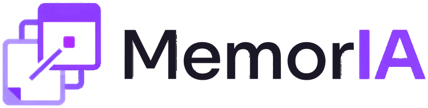

<p align="center"></p>

# Branding do MemorIA

O MemorIA é um app pessoal de organização em formato de calendário. O visual imita uma **agenda de papel pautada**: fundo de névoa, folhas brancas, texto em tinta quase preta, linhas de pauta lavanda e uma **caneta violeta** que marca tudo o que é ação ou destaque. O tema escuro é uma "noite violeta" com os mesmos nomes de cor.

Tudo aqui foi levantado do código (`src/index.css`, `index.html`, `src/assets/`, `public/` e componentes). Os valores calculados saem de scripts em [`scripts/`](scripts/).

| Arquivo                          | O que tem                                                                                                                                          |
| -------------------------------- | -------------------------------------------------------------------------------------------------------------------------------------------------- |
| [`cores.md`](cores.md)           | Lista completa de cores: tokens claro/escuro com hex, rgb e hsl, cores com papel próprio, categorias, contraste WCAG e cores fixas fora dos tokens |
| [`tipografia.md`](tipografia.md) | Fonte, origem, licença, pesos, larguras, escala de tamanhos                                                                                        |
| [`tokens.json`](tokens.json)     | Cores e fontes em formato de máquina (gerado por `scripts/gerar-tokens.mjs`)                                                                       |
| [`paleta.html`](paleta.html)     | Página única para abrir no navegador: amostras claro/escuro, top 3, contraste, fontes e logo                                                       |
| [`logo/`](logo/)                 | Cópias dos arquivos da logo que o app usa (originais intocados)                                                                                    |
| [`fonte/`](fonte/)               | Cópia do `.woff2` (latin) e da licença OFL, usados pela `paleta.html`                                                                              |
| [`scripts/`](scripts/)           | Scripts de contagem, cálculo e captura (rodam a partir da raiz do projeto)                                                                         |
| [`capturas/`](capturas/)         | Capturas do Início e da Semana com fundo liso, usadas na medição por área                                                                          |

---

## Cores em um minuto

| Cor              | Token                | Claro     | Escuro    | Papel                               |
| ---------------- | -------------------- | --------- | --------- | ----------------------------------- |
| Névoa            | `--nevoa`            | `#F4F2F8` | `#0F0D15` | Fundo da página                     |
| Papel            | `--papel`            | `#FFFFFF` | `#19161F` | Folhas, cards, menus                |
| Tinta            | `--tinta`            | `#111019` | `#ECE8F5` | Texto principal                     |
| Grafite          | `--grafite`          | `#625E70` | `#A39EB3` | Texto secundário                    |
| Pauta            | `--pauta`            | `#E4E0EE` | `#2C2738` | Linhas e bordas                     |
| **Caneta**       | `--caneta`           | `#8B3DFF` | `#A274FF` | **Cor da marca**: ação, ativo, foco |
| Violeta profundo | `--violeta-profundo` | `#4B16A8` | `#C6A8FF` | Destaques miúdos                    |
| Marca-texto      | `--marca-texto`      | `#ECE2FF` | `#2B2042` | Fundo só de atrasos                 |
| Alerta           | `--alerta`           | `#A84C0A` | `#F0A25E` | Laranja só em "Atrasadas"           |

Mais a barra lateral (`--barra` `#FBFAFD` / `#121017`), os apelidos do shadcn (`--primary` = caneta, `--accent` `#F1EAFF` / `#2A2240`, `--destructive` `#B42323` / `#F07A7A`…) e os fundos decorativos. Tudo em [`cores.md`](cores.md).

**Contraste:** todo par de texto principal passa **AA** nos dois temas, e o texto principal passa **AAA** (tinta sobre papel: 18,9:1 no claro, 14,8:1 no escuro). Tabela completa em [`cores.md`](cores.md#6-contraste-wcag).

**Categorias:** as 12 cores que o usuário escolhe para categorias (Tomate, Laranja, Mostarda… Grafite) **não são cores da marca**. No tema escuro elas aparecem clareadas 28%.

**Ícones:** a interface usa os ícones de traço do [lucide](https://lucide.dev) (ISC). Procedimentos e categorias podem ter um ícone escolhido pelo usuário: emoji (seletor frimousse com dados do Emojibase em português, MIT) ou logotipo de serviço do [Simple Icons](https://simpleicons.org) (CC0). Os logotipos **não são da marca MemorIA**: aparecem monocromáticos na cor oficial de cada marca, ajustada pela mesma regra das faixas de categoria (`corDeTraco`: no mínimo 3:1 sobre o papel em cada tema), sem mudar o desenho.

## As 3 cores mais usadas

### Por código (referências)

| #   | Cor         | Claro / Escuro        | Usos                                                                                                                                                                  | Onde aparece                                                    |
| --- | ----------- | --------------------- | --------------------------------------------------------------------------------------------------------------------------------------------------------------------- | --------------------------------------------------------------- |
| 1   | **grafite** | `#625E70` / `#A39EB3` | **194** (`grafite` 167 + `muted-foreground` 19 + `barra-suave` 8) (só `grafite`: 69 arquivos)                                                                         | Texto secundário, datas, contadores, rótulos, ícones discretos  |
| 2   | **caneta**  | `#8B3DFF` / `#A274FF` | **151** no claro, **154** no escuro (`caneta` 113 + `ring` 25 + `primary` 13/16) (só `caneta`: 52 arquivos)                                                           | Foco, item ativo, botões principais, links, ✓, checkbox marcada |
| 3   | **tinta**   | `#111019` / `#ECE8F5` | **119** no claro, **120** no escuro (`tinta` 61 + `foreground` 21/22 + `barra-texto` 15 + `accent-foreground` 12 + `popover-foreground` 8 + `secondary-foreground` 2) | Texto principal, títulos, botão "Criar"                         |

Contando só o nome direto, sem somar os apelidos, o top 3 é grafite (167), caneta (113) e **pauta** (68).

**Método:** conto cada classe Tailwind que usa o token (`bg-caneta`, `hover:text-tinta/60`, `bg-[color-mix(...var(--caneta)...)]`) e cada `var(--token)` em `src/**/*.{ts,tsx,css}`. Ficam de fora os testes e as linhas do `index.css` que só definem tokens; classe com `dark:` conta só no escuro. Cada apelido do shadcn é somado à cor-base para a qual aponta. Cores de categoria não entram (vêm do banco).

```bash
node docs/branding/scripts/contar-cores.mjs
```

### Por área visível

A contagem por código não reflete o que se vê: a **névoa** tem só 10 referências (`nevoa` + `background`), mas é o fundo da tela inteira. Por isso também medi pixels. As capturas são do Início e da Semana, a 1680×1000, com alguns grupos e tarefas e fundo "Liso" (a Aurora tinge a névoa e confunde a medição). Cada pixel foi para o token mais próximo, e o resultado é a média das duas telas:

| #   | Claro                      | Escuro                     |
| --- | -------------------------- | -------------------------- |
| 1   | **névoa** `#F4F2F8`: 53,9% | **névoa** `#0F0D15`: 52,6% |
| 2   | **papel** `#FFFFFF`: 30,4% | **papel** `#19161F`: 30,4% |
| 3   | **barra** `#FBFAFD`: 12,5% | **barra** `#121017`: 12,3% |

A caneta, cor da marca, ocupa menos de 1% da tela: aparece pouco e só onde importa.

```bash
node docs/branding/scripts/capturar-telas.mjs
python docs/branding/scripts/medir-area.py
```

## Tipografia

**Uma família só: [Bricolage Grotesque](https://github.com/ateliertriay/bricolage) Variable**, com pilha `'Bricolage Grotesque Variable', ui-sans-serif, system-ui, sans-serif`. Vem do pacote npm `@fontsource-variable/bricolage-grotesque` (arquivo local empacotado pelo Vite, sem Google Fonts em tempo de execução), sob a licença **SIL OFL 1.1**.

- Interface e títulos usam a mesma família (`--font-heading = --font-sans`).
- Os títulos são **condensados** pelo eixo de largura: 75% nos números grandes do calendário, 80% nos títulos de página, 85% nos títulos de seção e card. Usam peso 800 e espaçamento negativo.
- Pesos usados: 400, 500, 600, 700 e 800. O tamanho mais comum é `text-sm` (14/20 px).
- Monoespaçada: só a do sistema, num único campo (hexadecimal do misturador de cor).
- A logo **não usa fonte**: é imagem.

Detalhes em [`tipografia.md`](tipografia.md).

## Logo

| Versão                | Arquivo                                                                                         | Tamanho               | Uso                                                         |
| --------------------- | ----------------------------------------------------------------------------------------------- | --------------------- | ----------------------------------------------------------- |
| Completa, tema claro  | [`logo/logo-memoria-clara.png`](logo/logo-memoria-clara.png)                                    | 864×218               | Barra lateral no claro ("Memor" em `#1A1625`)               |
| Completa, tema escuro | [`logo/logo-memoria.png`](logo/logo-memoria.png)                                                | 864×218               | Barra lateral no escuro ("Memor" branco)                    |
| Símbolo, tema claro   | [`logo/simbolo-memoria-claro.png`](logo/simbolo-memoria-claro.png)                              | 218×218               | Barra recolhida no claro                                    |
| Símbolo, tema escuro  | [`logo/simbolo-memoria.png`](logo/simbolo-memoria.png)                                          | 218×218               | Barra recolhida no escuro                                   |
| Favicon               | [`logo/favicon.ico`](logo/favicon.ico) (16/32/48), [`logo/favicon-32.png`](logo/favicon-32.png) | 32×32                 | Aba do navegador (símbolo sobre ficha `#111019`)            |
| Ícone de atalho       | [`logo/apple-touch-icon.png`](logo/apple-touch-icon.png)                                        | 180×180               | Atalho na tela inicial                                      |
| Original              | [`logo/logo-original.png`](logo/logo-original.png)                                              | 1190×885, fundo opaco | Arte de origem (`img/logo.png`), de onde saíram os recortes |

**Formato:** todas as versões são **PNG**, sem SVG. Por isso não há `currentColor`. A troca por tema funciona com **dois pares de arquivo**: o `LogoDaBarra` (`src/app/barra-lateral.tsx`) renderiza os dois, e o CSS (`dark:`) mostra o do tema ativo e esconde o outro (`invisible`, que também o tira do leitor de tela). "IA" e o símbolo são violeta (≈ `#8B3DFF`, a caneta) nos dois temas.

**Regras de uso.** As regras de tamanho seguem o uso real no app; as demais são recomendações para quem for reaproveitar:

- **Tema:** a versão "clara" vai sobre fundo claro, a outra sobre fundo escuro.
- **Tamanho mínimo:** a completa com **32 px** de altura (tamanho na barra lateral, `h-8`). Menor que isso, use o **símbolo**, que vai até **16 px** (favicon).
- **Área de respiro:** no mínimo metade da altura da logo em volta (16 px para a logo de 32 px).
- **Não esticar:** mantenha a proporção 864×218 (≈ 4:1) na completa e 1:1 no símbolo.
- **Não trocar cores**, não aplicar sombra nem contorno, não recriar com texto.
- **Originais:** `img/` e `src/assets/` não devem ser alterados; esta pasta tem só cópias.

---

## Pontos de atenção

Encontrados durante o levantamento. **Nada foi corrigido**; fica registrado para decidir depois.

1. **Branco sobre caneta no escuro: 3,2:1.** A faixa cheia da visão de Ano usa `text-white` fixo (`src/features/ano/tons.ts:2`). No claro dá 5,0:1 (AA), mas no escuro a caneta clareia e o número fica abaixo de 4,5:1. O token `--primary-foreground` (texto escuro no escuro, 5,8:1) resolveria.
2. **Borda de campo com contraste baixo.** `--input` sobre o papel dá 1,6:1 (claro) e 1,5:1 (escuro), abaixo do 3:1 da WCAG 1.4.11 para limites de componente. O campo ainda se distingue pelo rótulo e pelo foco.
3. **Cores fixas fora dos tokens:** `bg-white` na moldura do desenho e na miniatura de anexo (ficam brancas no tema escuro). Também há os pincéis do desenho com hex próprios: a "Tinta" `#1b2838` não é a `--tinta` `#111019`. Lista completa em [`cores.md`](cores.md#7-cores-fixas-fora-dos-tokens).
4. **Manchas da Aurora sem token:** `#4f7dff` e `#d36bff` estão soltos dentro de `--fundo-mancha-2/3` (`src/index.css:146–147`).
5. **Valores copiados à mão em três lugares:** a névoa está em `index.html` (fundo antes do CSS carregar) e o papel em `PAPEL_DO_TEMA` (`src/lib/cores.ts:167`). Os dois são duplicações intencionais de `src/index.css`: mudou um, mude o outro.
6. **`--primary-foreground` no claro é `#ffffff` literal** em vez de `var(--papel)`. Hoje dá no mesmo; só diverge se o papel mudar.
7. **Token sem uso:** `--card-foreground` (0 referências).
8. **Não há token de sucesso.** `toast.success` usa o aviso neutro do Sonner (cores de popover). Não existe verde de marca.
9. **Dependência `next-themes` sobrando.** `src/components/ui/sonner.tsx` (gerado pelo shadcn) chama `useTheme()` do `next-themes`, mas o app passa o tema certo por prop no `LayoutApp`, então funciona. O pacote só existe por causa desse arquivo.
10. **Sem fonte monoespaçada própria.** `font-mono` (1 uso) cai na fonte do sistema e varia por computador. Não é problema; só não faz parte da marca.
11. **Logo só em PNG.** Não há SVG nem versão vetorial. Para impressão ou tamanhos grandes, a maior fonte é `img/logo.png` (1190×885, fundo opaco).

## Conferência

- As amostras da `paleta.html` foram comparadas com pixels das capturas do app real (Início e Semana, nos dois temas). Fundo, barra, card, item ativo e texto **batem exatamente** com os tokens: `#F4F2F8`/`#0F0D15`, `#FBFAFD`/`#121017`, `#FFFFFF`/`#19161F`, `#8B3DFF`/`#A274FF`, `#111019`/`#ECE8F5`.
- `tokens.json` validado com `JSON.parse`.
- Para regenerar tudo depois de mudar o tema, rode a partir da raiz:

```bash
node docs/branding/scripts/gerar-tokens.mjs
```
